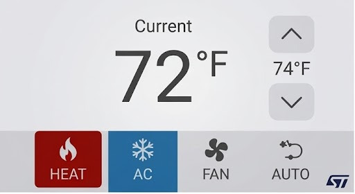

# STM32 Thermostat

A touch-operated digital thermostat UI running on an STM32F469I-DISCO
(STm32F469NIH6, Cortex-M4 @ 180 MHz). LVGL renders a single 800×480 screen
directly into double-buffered external SDRAM; the current temperature is fed
from an analog thermistor, and a simple UART protocol allows an external host
to drive the state.



## Features

- **Hero temperature display** with large generated digit font, setpoint
  chevron buttons, and a HEAT / AC / AUTO + FAN mode bar (FAN is an
  independent toggle)
- **800×480 DSI LCD** (OTM8009A) via LTDC, LVGL 9.5 software renderer,
  ARGB8888 double-buffered framebuffers in SDRAM with tear-free swap on LTDC
  refresh
- **Capacitive touch** (FT6206 on I2C1), polled as an LVGL pointer device
- **Idle backlight dim** over DSI (~5 s without touch), wake on touch
- **Thermistor input** (ADC1, PB1): single-shot read converted to °F via the
  B-parameter equation in pure integer math
- **UART host link** (115200 baud, USART3 on the ST-LINK VCP): non-blocking
  packet parser + device-side setters
- Onboard LEDs mirror the active mode for debug

## Hardware

| Item | Detail |
|---|---|
| Board | STM32F469I-DISCO (`disco_f469ni` in `platformio.ini`) |
| Display | 800×480 DSI LCD (OTM8009A) via LTDC |
| Framebuffers | External SDRAM @ `0xC0000000` / `0xC0180000`, LVGL heap @ `0xC0300000` |
| Touch | FT6206 on I2C1 (PB8/PB9), polled |
| Thermistor | PB1 (connector C8 "A0", ADC1_IN9), 10 kΩ NTC assumed |
| Debug / host UART | USART3 PB10/PB11 → ST-LINK VCP, 115200 baud |

## Building

Requires [PlatformIO](https://platformio.org). From the repo root:

```
pio run             # build firmware
pio run -t upload   # flash via ST-LINK (openocd)
pio run -t monitor  # serial console @ 115200 (ST-LINK VCP)
```

The build depends on compile flags in `platformio.ini` — notably
`-DHSE_VALUE=8000000UL` (this board's crystal is 8 MHz) and
`-DDATA_IN_ExtSDRAM` (SDRAM is initialized explicitly before the LCD).
Don't remove them.

## UART protocol

Frame: `[0x02] [CMD_ID] [LEN] [DATA...] [0x03]`

| CMD | Function | Payload |
|---|---|---|
| `0x50` | Set current temp | int16 LE, tenths of °F |
| `0x51` | Set mode | 1 byte (0=HEAT, 1=AC, 2=AUTO) |
| `0x53` | Set setpoint | int16 LE, tenths of °F |
| `0x54` | Set fan | 1 byte (0=off, 1=on) |
| `0x52` | Get state | *(planned — no TX path yet)* |

## Updating the screenshot

`mockup-ui.jpg` is a real capture of the framebuffer, not a mockup:

```
openocd -f interface/stlink.cfg -f target/stm32f4x.cfg \
    -c "transport select swd" -c "init" -c "halt" \
    -c "dump_image fb1.bin 0xC0000000 0x177000" \
    -c "dump_image fb2.bin 0xC0180000 0x177000" \
    -c "resume" -c "shutdown"

python3 tools/capture_screen.py fb2.bin mockup-ui.jpg
```

Keep the CPU halted for the whole dump (the UI redraws at ~1 Hz), and note
the displayed buffer reads back slowly due to LTDC bus contention. Both
buffers should match byte-for-byte — that confirms a stable frame.

## Layout

```
src/main.c              HAL init, boot sequence, superloop
src/thermostat_state.c  state model + UART packet parser
src/lvgl_display.c      LVGL ↔ LTDC/DSI/FT6206 port (flush, swap, touch, dim)
src/ui_main_screen.c    thermostat screen (pure LVGL)
src/adc_thermistor.c    thermistor ADC + B-parameter °F conversion
src/ui_font_*.c         generated fonts — regenerate per header comments
include/ui_icons.h      generated icons (tools/gen_icons.py)
lib/stm32_bsp/          vendored ST BSP (LCD/SDRAM/TS)
tools/                  icon generator, screen capture converter
SPECIFICATION.md        full system specification
```

## Status / roadmap

- `0x52` GET_STATE TX response + host daemon (Python)
- WS2812B shelf strip, mode-colored
- °C/°F toggle, schedules, setpoint persistence
